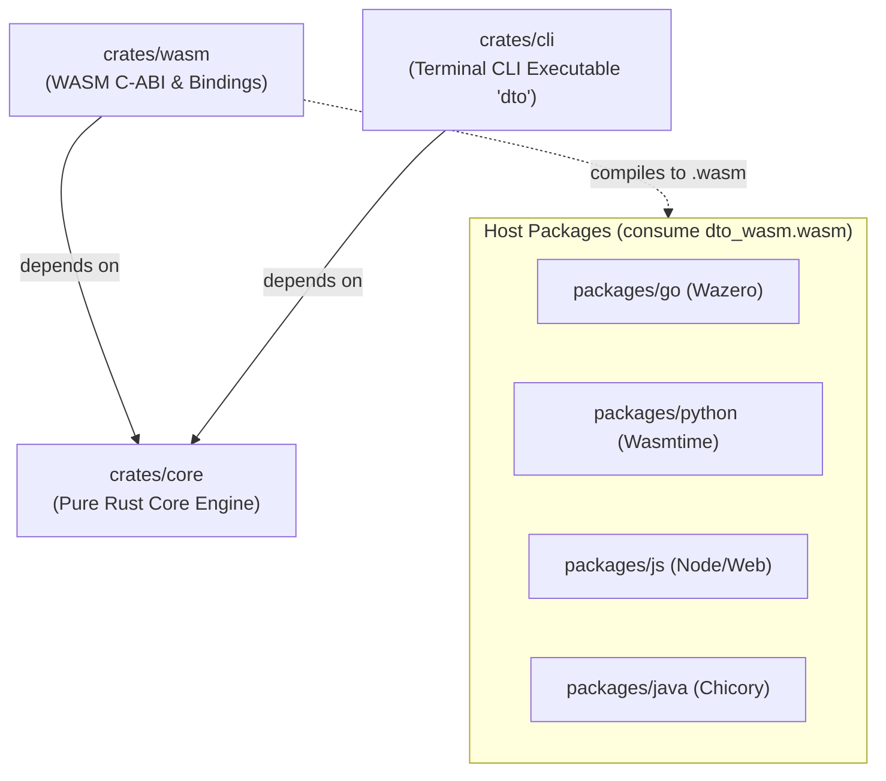

# Crates Directory (`crates/`)

In the Rust ecosystem, a **crate** is the fundamental compilation unit—equivalent to a **package** or **module** in Go, Python, or npm, or a **JAR** in Java.

Instead of prefixing every folder with `dto_` (which is redundant since the repository is already named `DTO`), the workspace is organized cleanly into three direct folders:

```
crates/
├── core/       # Pure Rust transformation & path query engine
├── wasm/       # WebAssembly bridge & C-ABI memory interface
└── cli/        # Command-line executable (dto) for terminal workflows
```

---

## 1. `core/` (Core Engine Library)

[`crates/core`](core) is the **heart of the project**. It is a pure, headless Rust library responsible for data parsing, navigation, transformation, and validation. It has zero WASM or CLI dependencies, meaning it can be embedded directly into any native Rust service or application.

### Internal Architecture

| Module | Location | Responsibility |
|---|---|---|
| **Path** | [`crates/core/src/path/`](core/src/path) | Tokenizes and resolves dot-notation paths (`user.profile.name`, `orders[0].id`, `items[-1].sku`, `roles[*].name`). Includes AST, tokenizer with syntax checks, and a recursive JSON value resolver. |
| **Recipe** | [`crates/core/src/recipe/`](core/src/recipe) | Handles the cooking-recipe format (`name`, `version`, `mappings`, `constraints`, `required`). Includes format auto-detection, inline pipe extraction, and compilation to schema AST. |
| **Schema** | [`crates/core/src/schema/`](core/src/schema) | Standard JSON Schema model supporting `x-from` and `x-transform` annotations with recursive object mapping. |
| **Functions** | [`crates/core/src/functions/`](core/src/functions) | 18 built-in transform functions with sequential chaining (`trim`, `lowercase`, `uppercase`, `to_string`, `to_number`, etc.). Automatically maps over array elements! |
| **Engine** | [`crates/core/src/engine/`](core/src/engine) | **Rayon multi-threaded batch processing** for non-blocking parallel transformation of array items, unified `DtoEngine` interface, and constraint validator. |

### How to Use in Native Rust

```rust
use dto_core::DtoEngine;
use serde_json::json;

fn main() -> Result<(), Box<dyn std::error::Error>> {
    let recipe = r#"{
        "name": "UserProfile",
        "mappings": [
            { "source": "user.name | trim | lowercase", "target": "cleanName" },
            { "source": "user.age | to_string", "target": "ageStr" }
        ],
        "required": ["cleanName"]
    }"#;

    let engine = DtoEngine::from_json(recipe)?;

    let input = json!({
        "user": {
            "name": "  ALICE SMITH  ",
            "age": 30
        }
    });

    let output = engine.transform(&input)?;
    println!("{}", output);
    // {"ageStr":"30","cleanName":"alice smith"}
    Ok(())
}
```

---

## 2. `wasm/` (WebAssembly Interface)

[`crates/wasm`](wasm) is the **bridge to the outside world**. It wraps `core` and compiles to a standalone WebAssembly (`.wasm`) binary (`wasm32-unknown-unknown`), enabling **Go**, **Python**, **JavaScript**, and **Java** to run the exact same Rust engine.

### Key Characteristics

- **Zero Host Dependencies**: When compiled without the `js` feature, it has **zero external imports** (`(import ...)` is empty). This allows it to run in pure WebAssembly engines like **Wazero (Go)**, **Wasmtime (Python)**, and **Chicory (Java)** without needing mock browser objects or CGO.
- **Thread-Safe Length-Prefixed Protocol**:
  1. Host allocates buffers in WASM linear memory using `dto_alloc`.
  2. Host writes schema and data UTF-8 JSON bytes.
  3. Host calls `dto_transform(schema_ptr, schema_len, data_ptr, data_len)`.
  4. Returns a pointer where the first 4 bytes indicate payload length `L` (little-endian `u32`), followed by `L` bytes of JSON payload.
  5. Host reads the output and frees memory via `dto_dealloc`.
  6. Re-entrant, atomic, and safe across concurrent host threads.
- **Optional `wasm-bindgen` Mode**: Toggleable via `--features js` for direct JavaScript/TypeScript DOM/Bundler integrations.

### Compiling WASM

```bash
# Build pure standalone WebAssembly binary
cargo build -p dto_wasm --target wasm32-unknown-unknown --release

# Output binary location:
# target/wasm32-unknown-unknown/release/dto_wasm.wasm
```

---

## 3. `cli/` (Command-Line Interface)

[`crates/cli`](cli) is a **standalone terminal executable** (`dto`) that provides a command-line interface to the engine. It is powered by `clap` and interacts directly with `core`.

### CLI Capabilities

- **File & Stdin Transformation**: Transform JSON data files or piped Unix streams.
- **Syntax Validation**: Validate recipes or schemas without supplying input data.
- **Function Discovery**: List all available transform functions and their descriptions.
- **Formatting**: Pretty-printed or minified JSON outputs.

### Usage Examples

```bash
# Transform a file with pretty printing
cargo run -p dto_cli -- transform -s recipe.json -i data.json --pretty

# Or using the binary alias directly
cargo run --bin dto -- transform -s recipe.json -i data.json

# Pipe input through stdin
cat data.json | cargo run --bin dto -- transform -s recipe.json

# Validate a recipe or schema
cargo run --bin dto -- validate -s recipe.json

# List all built-in transform functions
cargo run --bin dto -- functions
```

---

## Workspace Dependency Relationship


